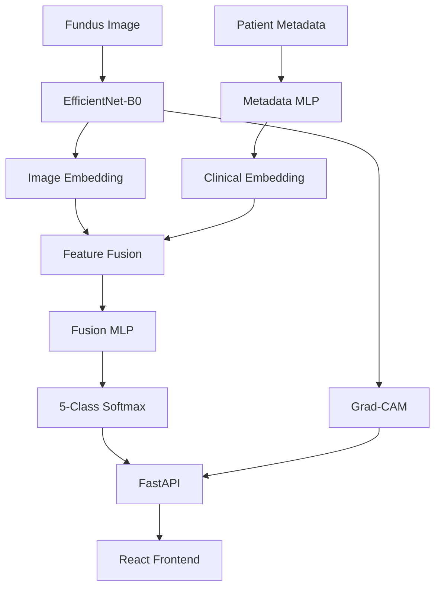

# ANTIGRAVITY MASTER BUILD PROMPT

## PROJECT TITLE

**RetinaVision — Multimodal AI-Assisted Retinal Screening and Research Platform**

---

# 1. ROLE

You are the lead full-stack ML engineer, deep-learning engineer, data engineer, UI/UX engineer, and software architect responsible for implementing this project from end to end.

Build the complete project as a professional academic/research prototype.

Do not create a toy application.

Do not create a fake ML pipeline.

Do not hard-code predictions.

Do not generate fake model probabilities.

Do not use placeholder prediction logic once the real model is available.

The system must contain:

* A real public retinal fundus-image dataset
* Real dataset acquisition/setup
* Real preprocessing
* Real train/validation/test splitting
* Real image-model training
* Real clinical/metadata-model training
* Real multimodal fusion-model training
* Real evaluation
* Real probability outputs
* Real Grad-CAM explainability
* A production-style React frontend
* A FastAPI backend
* Model inference through the backend
* Research/evaluation dashboards
* Educational retinal-health pages
* Proper medical/research disclaimers
* Reproducible configuration
* Logging
* Error handling
* Tests
* Documentation
* Setup scripts
* Training scripts
* Inference scripts

The core ML task is:

> **Use a retinal fundus image together with available patient/clinical information to classify diabetic retinopathy severity.**

The primary prediction target is:

**DR_ICDR**

with five classes:

* 0 = No diabetic retinopathy
* 1 = Mild non-proliferative diabetic retinopathy
* 2 = Moderate non-proliferative diabetic retinopathy
* 3 = Severe non-proliferative diabetic retinopathy
* 4 = Proliferative diabetic retinopathy / post-laser status

The exact class definitions must be derived from the verified dataset schema and documented in the project.

---

# 2. IMPORTANT DATASET REQUIREMENT

Use the official:

**Brazilian Multilabel Ophthalmological Dataset (BRSET)**

Target version:

**BRSET v1.0.2**

Official source:

PhysioNet BRSET.

Do not download the dataset from unofficial mirrors.

Do not scrape random websites.

Do not use fabricated data.

Do not use a Kaggle copy unless explicitly configured as an alternative by the developer/user.

The current official BRSET v1.0.2 contains:

* 16,266 fundus photographs
* 8,524 Brazilian patients
* patient-level identifiers
* demographic information
* diabetes information
* diabetes duration
* insulin use
* sex
* eye laterality
* DR severity
* anatomical annotations
* image-quality annotations
* multiple disease labels

The current official release requires credentialed PhysioNet access, required training, and a data-use agreement.

Therefore:

## DATASET ACCESS RULE

Implement an official dataset acquisition module.

The application must:

1. Check whether the BRSET dataset already exists locally.
2. Check whether the expected directory structure exists.
3. Check whether metadata files exist.
4. Validate that images are present.
5. Validate that metadata can be loaded.
6. Validate expected columns.
7. Print a clear dataset status report.
8. If official credentials/access are unavailable, do NOT attempt to bypass authentication.
9. Do NOT scrape or circumvent PhysioNet.
10. Do NOT silently download an unofficial copy.
11. Provide a clear setup instruction explaining that the user must obtain authorized access and place/download the files through the official mechanism.
12. Once the dataset is available locally, continue automatically with validation and preprocessing.

Create:

`src/data/download_brset.py`

and:

`src/data/validate_brset.py`

and:

`configs/dataset.yaml`

---

# 3. DATASET VALIDATION

Before training anything, inspect the actual dataset.

Do not assume the schema blindly.

Print:

* Number of rows
* Number of unique patients
* Number of unique images
* Number of duplicate image IDs
* Number of duplicate patient IDs
* Missing-value counts
* Class counts
* Class percentages
* Sex distribution
* Age statistics
* Diabetes distribution
* Diabetes-duration statistics
* Insulin-use distribution
* Eye-laterality distribution
* Image availability
* Broken image count
* Unsupported image formats
* Corrupted image count

Expected important fields include:

* `image_id`
* `patient_id`
* `patient_age`
* `patient_sex`
* `diabetes`
* `diabetes_time`
* `insulin_use`
* `exam_eye`
* `DR_ICDR`

However, NEVER hard-code assumptions if the downloaded version differs.

Create a schema inspection report.

If a required field is absent:

* Stop the affected training pipeline.
* Explain exactly which field is missing.
* Do not fabricate it.
* Do not infer it from unrelated fields.

---

# 4. DATA LEAKAGE PREVENTION

This is extremely important.

The system must prevent patient-level leakage.

If multiple images belong to the same patient, all images from that patient must remain in the same split.

Never allow:

* Patient A image 1 → training
* Patient A image 2 → test

Create a patient-level split.

Preferred:

* Train: approximately 70%
* Validation: approximately 15%
* Test: approximately 15%

Use a fixed random seed.

Where possible, maintain class balance across splits.

Save the actual split files:

`data/processed/train.csv`

`data/processed/val.csv`

`data/processed/test.csv`

Also save:

`data/processed/split_summary.json`

The script must verify:

* No patient overlap between train and validation
* No patient overlap between train and test
* No patient overlap between validation and test
* No image overlap between splits

If overlap exists, fail loudly.

---

# 5. PRIMARY ML TASK

The main ML task is:

## Multiclass diabetic-retinopathy severity classification

Input:

* Fundus image
* Patient/clinical metadata

Output:

Five-class DR severity prediction.

The model must output a probability distribution over all five classes.

Example:

```text
No DR: 0.06
Mild DR: 0.13
Moderate DR: 0.71
Severe DR: 0.08
Proliferative DR: 0.02
```

These are examples only.

Never hard-code these values.

The actual values must come from the trained model.

The predicted class is:

`argmax(probabilities)`

The frontend must display the probabilities returned by the backend.

---

# 6. MULTIMODAL DESIGN

The project must contain three comparable models.

## MODEL A — IMAGE ONLY

Input:

Fundus image.

Architecture:

```text
Fundus Image
     ↓
Image preprocessing
     ↓
EfficientNet-B0
     ↓
Image embedding
     ↓
Classification head
     ↓
5-class DR prediction
```

Use ImageNet-pretrained EfficientNet-B0 initially.

Allow configuration of:

* Freeze backbone
* Unfreeze selected layers
* Full fine-tuning

Default training strategy:

1. Start with frozen or mostly frozen backbone.
2. Train classification head.
3. Optionally fine-tune upper backbone layers.
4. Save best validation checkpoint.

---

# 7. MODEL B — CLINICAL/METADATA ONLY

Use only information realistically available at inference time.

Primary metadata:

* Patient age
* Patient sex
* Diabetes status
* Diabetes duration
* Insulin use
* Eye laterality

Do not use:

* DR_ICDR
* DR_SDRG
* diabetic_retinopathy
* macular_edema
* anatomical labels
* optic_disc
* vessels
* macula
* focus
* illumination
* image_field
* artifacts
* other diagnosis labels

Those are dataset labels/annotations and must not be used as input features.

Architecture:

```text
Age
Sex
Diabetes
Diabetes Duration
Insulin Use
Eye Laterality
       ↓
Preprocessing
       ↓
MLP
       ↓
Clinical embedding
       ↓
Classification head
       ↓
5-class DR prediction
```

For categorical features:

Use an appropriate encoding strategy.

For numerical features:

Use training-set-fitted scaling.

For missing values:

Use training-set-fitted imputation.

Save all preprocessing artifacts.

---

# 8. MODEL C — MULTIMODAL MAIN MODEL

This is the primary research model.

Architecture:

```text
                 FUNDUS IMAGE
                      ↓
                EfficientNet-B0
                      ↓
                Image Embedding
                      │
                      │
                      ├─────────────┐
                                    ↓
Clinical Metadata → MLP → Clinical Embedding
                                    ↓
                           Feature Concatenation
                                    ↓
                              Fusion MLP
                                    ↓
                            Classification Head
                                    ↓
                                 Softmax
                                    ↓
                         5-class DR probabilities
```

Do not use an LLM as the classifier.

Do not use an LLM to produce probabilities.

Do not ask an LLM to invent medical predictions.

The multimodal PyTorch model must produce the probabilities.

---

# 9. OPTIONAL FUTURE MULTIMODAL EXTENSION

Keep the architecture modular enough to support additional modalities later.

Possible future inputs include:

* Image-quality features
* Anatomical features
* Additional retinal imaging modalities
* OCT
* longitudinal patient information

However:

DO NOT add these to the first model unless the data is genuinely available and usable at inference time.

Do not make the V1 unnecessarily complex.

---

# 10. IMAGE PREPROCESSING

Default image size:

`224 x 224`

Use:

* RGB conversion
* Resize
* Appropriate crop/resize strategy
* ImageNet normalization for ImageNet-pretrained EfficientNet

Training augmentation may include:

* Horizontal flip where medically appropriate
* Small rotations
* Mild affine transforms
* Mild brightness/contrast variation
* Mild cropping/scaling

Do not use aggressive transformations that can destroy clinically meaningful retinal structures.

Validation and test preprocessing must be deterministic.

Create:

`src/data/image_transforms.py`

---

# 11. CLINICAL PREPROCESSING

Create a reusable metadata preprocessing pipeline.

Numerical:

* patient_age
* diabetes_time

Categorical/binary:

* patient_sex
* diabetes
* insulin_use
* exam_eye

Handle missing values explicitly.

Fit all transformations ONLY on training data.

Never fit scalers/encoders using validation or test data.

Save:

`models/preprocessing/metadata_preprocessor.pkl`

or an equivalent serialized artifact.

Also save a human-readable:

`models/preprocessing/metadata_schema.json`

---

# 12. TARGET PREPROCESSING

Target:

`DR_ICDR`

Map it explicitly:

```text
0 → No DR
1 → Mild NPDR
2 → Moderate NPDR
3 → Severe NPDR
4 → Proliferative DR / post-laser
```

Do not silently remap classes.

Validate that all expected target classes exist.

If a class is missing from a particular experimental subset, report it clearly.

---

# 13. CLASS IMBALANCE

Analyze class distribution before training.

Do not assume balanced data.

Support:

* Class-weighted CrossEntropyLoss
* Weighted sampling as an optional configuration
* Macro F1
* Balanced accuracy

Default to class-weighted loss if appropriate.

Document the selected strategy.

Do not oversample validation/test sets.

---

# 14. TRAINING CONFIGURATION

Use PyTorch.

Default optimizer:

AdamW.

Initial learning rate:

`1e-4`

Initial weight decay:

`1e-4`

Make all settings configurable.

Example:

`configs/training.yaml`

Include:

* seed
* batch size
* epochs
* learning rate
* weight decay
* image size
* num classes
* patience
* optimizer
* scheduler
* backbone
* freeze_backbone
* mixed_precision
* num_workers

Do not hard-code values throughout the codebase.

---

# 15. TRAINING LOOP

Implement a reusable training engine.

Each epoch must report:

* Training loss
* Validation loss
* Accuracy
* Macro F1
* Balanced accuracy

Optionally:

* Per-class F1
* Per-class recall
* Per-class precision

Save the best checkpoint based on a configurable validation metric.

Default:

Macro F1.

Implement early stopping.

Save:

`models/checkpoints/image_only_best.pt`

`models/checkpoints/clinical_only_best.pt`

`models/checkpoints/multimodal_best.pt`

---

# 16. QUICK TEST MODE

The entire pipeline must support a quick test mode.

Example:

```bash
python train.py --quick-test
```

Quick test should:

* Use a small subset
* Use very few epochs
* Validate the entire pipeline
* Confirm image loading
* Confirm metadata preprocessing
* Confirm model forward pass
* Confirm loss calculation
* Confirm checkpoint saving
* Confirm inference
* Confirm Grad-CAM
* Confirm API inference

This mode exists to catch implementation errors before expensive training.

---

# 17. FULL TRAINING MODE

Example:

```bash
python train.py --model multimodal
```

Support:

```bash
python train.py --model image_only
python train.py --model clinical_only
python train.py --model multimodal
```

Also support:

```bash
python train.py --all
```

which trains all three models sequentially.

---

# 18. EXPERIMENT TRACKING

Maintain an experiment directory.

For every experiment save:

* Configuration
* Dataset split identifier
* Seed
* Model architecture
* Number of parameters
* Training duration
* Best epoch
* Best validation metric
* Final test metrics
* Checkpoint path

Example:

`outputs/experiments/multimodal_YYYYMMDD_HHMMSS/`

---

# 19. EVALUATION

Evaluate all three models on the SAME held-out test set.

Generate:

* Accuracy
* Balanced accuracy
* Macro precision
* Macro recall
* Macro F1
* Weighted F1
* Per-class precision
* Per-class recall
* Per-class F1
* Confusion matrix

For multiclass ROC-AUC:

Use one-vs-rest multiclass ROC-AUC only when statistically appropriate and report the averaging method.

Also consider:

* PR-AUC
* Calibration
* Brier score
* Expected Calibration Error

Do not present metrics that cannot be calculated correctly.

---

# 20. MODEL COMPARISON

Create a research comparison table:

```text
Model              Accuracy    Macro F1    Balanced Acc.
----------------------------------------------------------
Image-only          XX.XX%       XX.XX%        XX.XX%
Clinical-only       XX.XX%       XX.XX%        XX.XX%
Multimodal          XX.XX%       XX.XX%        XX.XX%
```

The values must be generated from actual test evaluation.

Never fabricate them.

Do not automatically claim that the multimodal model is superior.

The research question is whether multimodal information adds useful predictive information.

If the multimodal model performs worse, report that honestly.

---

# 21. PROBABILITY CALIBRATION

Softmax probabilities are not automatically perfectly calibrated.

Implement optional validation-set temperature scaling.

If enabled:

1. Train model.
2. Generate validation logits.
3. Fit temperature using validation data.
4. Apply temperature to logits.
5. Generate calibrated probabilities.
6. Evaluate calibration.
7. Save calibration parameter.

Do not fit calibration on the test set.

Frontend labels should distinguish:

* Model probability
* Calibrated model probability, if calibration is enabled

Never call the probability a clinical certainty.

---

# 22. GRAD-CAM

Implement Grad-CAM for the image branch.

The user should be able to see:

1. Original fundus image
2. Grad-CAM heatmap
3. Overlay image

Save or return the visualization through the API.

Use the final convolutional feature layer appropriate for EfficientNet-B0.

Do not claim that Grad-CAM proves medical reasoning.

Display:

> “Highlighted regions represent image areas that contributed to the model output. This visualization is an interpretability aid and does not establish clinical causality.”

---

# 23. INFERENCE PIPELINE

Create:

`src/inference/predictor.py`

Input:

* image
* metadata

Process:

```text
Validate request
      ↓
Image preprocessing
      ↓
Metadata preprocessing
      ↓
Load model
      ↓
Image branch
      ↓
Clinical branch
      ↓
Fusion
      ↓
Logits
      ↓
Probability conversion
      ↓
Predicted class
      ↓
Grad-CAM
      ↓
Structured response
```

Return:

* predicted class index
* predicted class name
* probability for each class
* optional calibrated probabilities
* Grad-CAM path/base64/URL
* model version
* preprocessing version

---

# 24. FASTAPI BACKEND

Build a clean FastAPI backend.

Suggested structure:

```text
backend/
├── main.py
├── api/
│   ├── routes_health.py
│   ├── routes_prediction.py
│   └── routes_info.py
├── schemas/
├── services/
├── inference/
├── preprocessing/
└── core/
```

Endpoints:

### GET `/health`

Returns:

```json
{
  "status": "ok",
  "model_loaded": true
}
```

### GET `/model-info`

Returns:

* Model name
* Model version
* Classes
* Architecture
* Dataset version
* Training date

### POST `/predict`

Accept:

* fundus image
* patient_age
* patient_sex
* diabetes
* diabetes_time
* insulin_use
* exam_eye

Return:

* prediction
* probabilities
* Grad-CAM
* model information

---

# 25. API VALIDATION

Validate:

* image exists
* image format
* image size
* age range
* allowed sex values
* diabetes values
* diabetes duration
* insulin values
* eye laterality

Reject malformed requests with clear errors.

Do not expose internal stack traces to users.

---

# 26. REACT FRONTEND

Build the frontend using:

* React
* TypeScript
* Tailwind CSS
* React Router
* A professional component system
* Charting library where useful

Do not build the entire application as one component.

Use reusable components.

Suggested:

```text
frontend/
├── src/
│   ├── components/
│   ├── pages/
│   ├── layouts/
│   ├── hooks/
│   ├── services/
│   ├── types/
│   ├── utils/
│   └── assets/
```

---

# 27. DESIGN LANGUAGE

The UI must look like a modern professional AI healthcare/research platform.

Use:

* Clean white/light background
* Deep blue/indigo medical-academic accent
* Subtle gradients
* Rounded cards
* Clear typography
* Professional spacing
* Minimal animations
* Accessible contrast
* Responsive layout
* Desktop-first but mobile-friendly

Do not make it look like a generic admin dashboard.

Do not overuse gradients.

Do not use cartoon medical graphics.

Use professional retinal/ophthalmology imagery where appropriate and where licensing permits.

---

# 28. GLOBAL NAVIGATION

Navigation:

```text
RetinaVision

Home
Learn
How AI Works
Analyze
Research
History
About
```

Include:

* Logo/brand
* Navigation links
* Active-page indicator
* Responsive mobile menu
* Footer
* Research disclaimer

---

# 29. HOME PAGE

Create a premium landing page.

Hero:

```text
Multimodal AI for
Retinal Screening Research

Combining retinal fundus imaging with
patient information to study diabetic
retinopathy severity classification.

[ Analyze Retina ]
[ Explore How AI Works ]
```

Include a visual representation of:

```text
Fundus Image
+
Patient Information
↓
Multimodal AI
↓
Retinopathy Classification
```

Include sections:

* What the project does
* Why multimodal AI
* How it works
* Explainability
* Research objective
* Dataset information
* Disclaimer

---

# 30. LEARN PAGE

Create an educational page about diabetic retinopathy.

Sections:

### What is diabetic retinopathy?

Explain in simple, neutral language.

### Severity levels

Create cards:

* No DR
* Mild NPDR
* Moderate NPDR
* Severe NPDR
* Proliferative DR

Do not claim the website can clinically diagnose these conditions.

### Risk/context information

Explain that diabetes duration and other patient factors can be relevant context.

### Fundus photography

Explain:

* What a fundus image is
* What the camera captures
* Why fundus photographs can be used in AI research

### Screening concept

Explain that screening systems can support research and awareness, but this prototype is not clinically validated.

---

# 31. HOW AI WORKS PAGE

Make this page visually impressive.

Show the architecture:

```text
Fundus Image
     ↓
EfficientNet-B0
     ↓
Image Embedding
```

and:

```text
Patient Data
     ↓
Metadata MLP
     ↓
Clinical Embedding
```

then:

```text
Image Embedding
       +
Clinical Embedding
       ↓
Feature Fusion
       ↓
Fusion MLP
       ↓
5-Class Prediction
```

Explain each component.

---

# 32. THREE-MODEL COMPARISON SECTION

On the How AI Works page, explain:

### Image-only

Uses retinal image.

### Clinical-only

Uses patient/clinical metadata.

### Multimodal

Combines both.

Clearly state:

> The multimodal model is the primary research model, while the other two are baseline models used for comparison.

---

# 33. ANALYZE PAGE

Create a professional form.

Section 1:

## Upload Fundus Image

Use drag-and-drop.

Support:

* JPG
* JPEG
* PNG

Show image preview.

Provide:

* Remove image
* Replace image
* Zoom/preview

---

# 34. PATIENT INFORMATION FORM

Only request information that corresponds to the model's trained metadata.

Fields:

### Age

Number input.

### Sex

Select:

* Male
* Female

### Diabetes

Select:

* Yes
* No
* Unknown, if the trained model supports unknown values

### Diabetes duration

Number of years.

Allow “unknown” if supported by preprocessing.

### Insulin use

* Yes
* No
* Unknown

### Eye

* Right
* Left

Do not ask the user to manually enter:

* DR severity
* retinal hemorrhage
* macular edema
* optic disc status
* vessel status
* macula status
* image quality
* artifacts

Those are model/dataset annotations, not user input.

---

# 35. FORM UX

Show clear labels.

Use helper text.

Show required/optional state.

Show validation errors inline.

Disable Analyze until required fields are valid.

Display:

> Your information is processed for this research prototype and should not be interpreted as a clinical diagnosis.

Do not collect unnecessary personally identifiable information.

Do not ask for:

* name
* phone number
* email
* address
* national ID
* medical record number

unless explicitly required for a future authenticated application.

---

# 36. ANALYSIS LOADING STATE

When the user clicks:

**Analyze Retina**

show a polished loading workflow:

```text
Preparing retinal image
        ✓
Processing patient information
        ✓
Extracting visual features
        ●
Combining modalities
        ○
Generating prediction
        ○
Generating explanation
        ○
```

Do not fake progress percentages.

Use actual backend request state.

---

# 37. RESULTS PAGE

Build a rich results page.

Top section:

```text
Analysis Result

Predicted DR Severity

Moderate Diabetic Retinopathy

Model probability: XX%
```

Do not say:

* Confirmed diagnosis
* 100% diagnosis
* You have DR
* Treatment required

Use:

* Predicted class
* Model probability
* Research prediction
* AI classification

---

# 38. PROBABILITY DISTRIBUTION

Create a beautiful chart.

Show all five classes:

```text
No DR
Mild NPDR
Moderate NPDR
Severe NPDR
Proliferative DR
```

Use actual backend probabilities.

Ensure they sum approximately to 100%.

Do not round in a way that creates obviously incorrect totals.

---

# 39. VISUAL EXPLANATION

Create a side-by-side card:

```text
Original Fundus Image

[ IMAGE ]
```

and:

```text
Grad-CAM

[ HEATMAP OVERLAY ]
```

Allow:

* Toggle original
* Toggle heatmap
* Toggle overlay
* Zoom

Include explanation:

> The heatmap shows image regions that contributed to the model output. It is an interpretability visualization and is not a clinical diagnostic finding.

---

# 40. PATIENT SUMMARY

Display only the information supplied for the analysis.

Example:

```text
Patient Context

Age: 57
Sex: Male
Diabetes: Yes
Diabetes duration: 12 years
Insulin use: Yes
Eye: Right
```

Do not invent missing values.

---

# 41. MODEL INFORMATION

Show:

```text
Model
Multimodal EfficientNet + MLP

Image Encoder
EfficientNet-B0

Clinical Encoder
MLP

Fusion
Concatenation + Fusion MLP

Classes
5

Model Version
v1.x
```

---

# 42. RESEARCH PAGE

Create a polished research dashboard.

Include:

### Dataset statistics

* Images
* Patients
* Classes
* Metadata fields

Use values generated from the local dataset inspection rather than hard-coded numbers where possible.

### Model comparison

Show:

* Image-only
* Clinical-only
* Multimodal

Metrics:

* Accuracy
* Macro F1
* Balanced accuracy
* Precision
* Recall

---

# 43. CONFUSION MATRIX

Display a confusion matrix for the multimodal model.

Axes:

Predicted vs actual.

Use clear class labels.

Add tooltip/details where appropriate.

---

# 44. TRAINING CURVES

Display:

* Training loss
* Validation loss
* Training metric
* Validation metric

Use actual saved experiment history.

Do not fabricate curves.

---

# 45. CLASS DISTRIBUTION

Show:

* Number of samples per DR class
* Percentage per class

This is important for explaining class imbalance.

---

# 46. RESEARCH INTERPRETATION

Add a neutral section:

```text
Research Question

Does combining fundus-image features with
patient metadata provide useful additional
information for diabetic-retinopathy severity
classification?
```

Then show the actual results.

Do not automatically state that multimodal is better.

Use:

> “In this experiment, the multimodal model achieved…”

based on actual results.

---

# 47. HISTORY PAGE

Create an analysis-history page.

For the first version, history can be stored in browser local storage.

Do not introduce a database unless necessary.

Each entry can contain:

* Timestamp
* Predicted class
* Highest probability
* Image thumbnail
* Model version

Do not store sensitive personal information unnecessarily.

Provide:

* View result
* Delete local history
* Clear history

Clearly state that history is stored locally in the browser if that is how it works.

---

# 48. ABOUT PAGE

Include:

## Project

RetinaVision.

## Objective

Research prototype for multimodal diabetic-retinopathy severity classification.

## Dataset

BRSET v1.0.2, subject to authorized access.

## Machine Learning

PyTorch.

## Image Model

EfficientNet-B0.

## Clinical Model

MLP.

## Fusion

Feature concatenation + fusion MLP.

## Explainability

Grad-CAM.

## Backend

FastAPI.

## Frontend

React + TypeScript.

---

# 49. MEDICAL DISCLAIMER

Use a highly visible disclaimer.

Suggested wording:

> **Research and Educational Prototype**
>
> RetinaVision is an academic/research prototype for studying multimodal machine learning using retinal fundus images and patient information. It has not been clinically validated and is not a medical diagnostic device. Model outputs and visual explanations should not be used to make medical decisions, determine treatment, or replace evaluation by a qualified healthcare professional.

Do not make the interface alarmist.

---

# 50. LLM POLICY

An LLM is NOT part of the core prediction model.

Do not use an LLM to:

* Predict DR severity
* Generate probabilities
* Override the classifier
* Diagnose the patient
* Recommend treatment
* Generate medical certainty

If an LLM is implemented later, it must be an optional educational explanation layer.

Architecture:

```text
Multimodal ML Model
        ↓
Prediction + probabilities + Grad-CAM
        ↓
Optional LLM
        ↓
Plain-language explanation
```

The LLM must not alter the underlying prediction.

For V1, keep the LLM disabled unless explicitly enabled by configuration.

---

# 51. NO HARD-CODED PREDICTIONS

Absolutely no code like:

```python
prediction = "Moderate DR"
```

No fake probabilities.

No random predictions.

No UI demo data presented as real inference.

For demo mode, if included, clearly label it:

**DEMO MODE — NOT A REAL MODEL PREDICTION**

Prefer not to include demo mode in the final production-like build.

---

# 52. PROJECT STRUCTURE

Create:

```text
retinavision/
│
├── frontend/
│   ├── src/
│   │   ├── components/
│   │   ├── pages/
│   │   ├── layouts/
│   │   ├── hooks/
│   │   ├── services/
│   │   ├── types/
│   │   └── utils/
│   ├── package.json
│   └── README.md
│
├── backend/
│   ├── main.py
│   ├── api/
│   ├── schemas/
│   ├── services/
│   ├── inference/
│   ├── preprocessing/
│   └── core/
│
├── src/
│   ├── data/
│   ├── models/
│   ├── training/
│   ├── evaluation/
│   ├── explainability/
│   ├── inference/
│   └── utils/
│
├── configs/
│   ├── dataset.yaml
│   ├── training.yaml
│   └── model.yaml
│
├── data/
│   ├── raw/
│   ├── interim/
│   └── processed/
│
├── models/
│   ├── checkpoints/
│   └── preprocessing/
│
├── outputs/
│   ├── figures/
│   ├── metrics/
│   ├── reports/
│   └── experiments/
│
├── notebooks/
│
├── tests/
│
├── scripts/
│
├── requirements.txt
├── README.md
└── .gitignore
```

---

# 53. DATA DIRECTORY SAFETY

Do not commit restricted dataset files to Git.

`.gitignore` must include:

```text
data/raw/
data/interim/
models/checkpoints/
*.pt
*.pth
*.pkl
.env
```

If required, commit only:

* metadata schema
* split-generation scripts
* documentation
* small non-sensitive test fixtures

---

# 54. ENVIRONMENT CONFIGURATION

Create `.env.example`.

Include only non-sensitive configuration.

Example:

```text
MODEL_PATH=...
API_HOST=...
API_PORT=...
FRONTEND_URL=...
DATASET_ROOT=...
```

Never commit secrets.

---

# 55. REQUIREMENTS

Python dependencies should include appropriate versions of:

* torch
* torchvision
* pandas
* numpy
* scikit-learn
* pillow
* opencv-python
* matplotlib
* seaborn if desired for offline analysis
* grad-cam / pytorch-grad-cam
* fastapi
* uvicorn
* python-multipart
* pydantic
* joblib
* PyYAML

Frontend dependencies:

* React
* TypeScript
* React Router
* Tailwind CSS
* charting library
* icon library

Pin versions where practical.

---

# 56. DEVICE SUPPORT

Automatically detect:

* CUDA
* Apple MPS where applicable
* CPU

Use:

```text
CUDA > MPS > CPU
```

where supported.

Display the selected device in training logs.

Do not fail if GPU is unavailable.

---

# 57. MIXED PRECISION

Support mixed-precision training on compatible CUDA devices.

Make it configurable.

Example:

```yaml
mixed_precision: true
```

Automatically disable it when unsupported.

---

# 58. REPRODUCIBILITY

Set random seeds for:

* Python
* NumPy
* PyTorch

Where possible, configure deterministic behavior.

Log:

* seed
* Python version
* PyTorch version
* torchvision version
* CUDA version
* GPU name
* dataset version
* model configuration

---

# 59. LOGGING

Use structured logging.

Training logs should include:

```text
Epoch
Train Loss
Validation Loss
Accuracy
Macro F1
Balanced Accuracy
Learning Rate
```

Save logs to:

`outputs/logs/`

---

# 60. MODEL CHECKPOINTING

Save:

* model state
* optimizer state
* scheduler state
* epoch
* best metric
* configuration
* class mapping

A checkpoint must be sufficient to resume or reproduce inference.

---

# 61. INFERENCE MODEL LOADING

FastAPI should load the model once at startup rather than loading it for every request.

Use startup/lifespan initialization.

If model loading fails:

* `/health` must indicate model unavailable
* `/predict` must return a controlled error
* Do not crash silently

---

# 62. API RESPONSE SCHEMA

Use a strongly typed Pydantic response.

Conceptually:

```json
{
  "prediction": {
    "class_id": 2,
    "class_name": "Moderate diabetic retinopathy",
    "probability": 0.71
  },
  "probabilities": [
    {
      "class_id": 0,
      "class_name": "No DR",
      "probability": 0.06
    }
  ],
  "explanation": {
    "gradcam_available": true
  },
  "model": {
    "name": "RetinaVision Multimodal",
    "version": "1.0.0"
  }
}
```

Actual values must come from inference.

---

# 63. FRONTEND API SERVICE

Create:

`frontend/src/services/api.ts`

Do not scatter fetch/axios calls across components.

Use a centralized API service.

Handle:

* loading
* success
* validation errors
* backend errors
* timeout
* network failure

---

# 64. ERROR UX

If the image is invalid:

> Please upload a valid retinal fundus image.

If the backend is unavailable:

> The analysis service is currently unavailable. Please try again.

If model is unavailable:

> The AI model is not currently loaded. Please contact the project administrator.

Do not show Python tracebacks to users.

---

# 65. RESPONSIVE DESIGN

Ensure:

* Desktop
* Tablet
* Mobile

The analysis page should stack cleanly on small screens.

Results cards should remain readable.

Charts should resize correctly.

---

# 66. ACCESSIBILITY

Use:

* Semantic HTML
* Keyboard navigation
* Accessible form labels
* ARIA labels where necessary
* Sufficient contrast
* Focus states
* Alt text for meaningful images

---

# 67. SECURITY BASICS

Validate uploaded file types.

Limit file size.

Do not execute uploaded files.

Store temporary uploads safely.

Delete temporary files after inference when appropriate.

Do not log uploaded medical images.

Do not log raw patient metadata unnecessarily.

---

# 68. PRIVACY

The prototype should minimize collection.

Do not ask for personally identifiable information.

Do not store names or contact details.

If local history is implemented, explain clearly that it is stored locally.

Do not send patient information to external APIs.

Do not send retinal images to an external LLM.

Do not use third-party AI APIs for the core model.

---

# 69. DATABASE

Do NOT add a database in V1.

Use local/browser history.

The primary architecture should remain:

```text
React
 ↓
FastAPI
 ↓
PyTorch
```

A database can be added later if the project requires authenticated users or persistent research records.

---

# 70. KUBERNETES

Do NOT make Kubernetes a requirement for the core implementation.

The project should run locally using:

```text
Frontend
Backend
Model
```

Optionally provide Docker support later.

Kubernetes should be treated as a deployment extension, not part of the ML research requirement.

---

# 71. DOCKER

Optionally create:

* `frontend/Dockerfile`
* `backend/Dockerfile`
* `docker-compose.yml`

The Docker setup must not require the restricted dataset to be copied into the image.

Mount the dataset/model directories as volumes or provide clear setup instructions.

---

# 72. NO KUBERNETES BY DEFAULT

Do not spend implementation time on Kubernetes until:

* Dataset works
* Training works
* Evaluation works
* Inference works
* FastAPI works
* React works

---

# 73. DATA EXPLORATION NOTEBOOK

Create:

`notebooks/01_dataset_exploration.ipynb`

Include:

* Dataset shape
* Patient count
* Image count
* Missing values
* Class distribution
* Age distribution
* Sex distribution
* Diabetes distribution
* Diabetes duration
* Insulin usage
* Eye laterality
* Example images
* Quality statistics where useful

Do not expose sensitive information.

---

# 74. PREPROCESSING NOTEBOOK

Create:

`notebooks/02_preprocessing_validation.ipynb`

Include:

* Image preprocessing examples
* Metadata encoding
* Missing-value handling
* Split verification
* Leakage verification

---

# 75. TRAINING NOTEBOOK

Create:

`notebooks/03_training_experiments.ipynb`

The notebook may call reusable Python modules.

Do not put the entire ML implementation only inside the notebook.

The actual production pipeline must exist as Python modules.

---

# 76. EVALUATION NOTEBOOK

Create:

`notebooks/04_evaluation.ipynb`

Include:

* Metrics
* Confusion matrix
* ROC curves if appropriate
* PR curves if appropriate
* Calibration
* Model comparison
* Error analysis

---

# 77. ERROR ANALYSIS

Create an evaluation script that identifies:

* Correct predictions
* Incorrect predictions
* Most confused classes
* Low-confidence predictions
* High-confidence incorrect predictions

Display representative examples for research analysis.

Do not expose patient-identifiable information.

---

# 78. CONFIDENCE HANDLING

Do not interpret high model probability as clinical certainty.

If confidence is low, the UI may say:

> “The model shows lower confidence in this classification.”

Do not say:

> “The model is unsure whether you have the disease.”

---

# 79. OPTIONAL UNCERTAINTY INDICATOR

If implemented, define it clearly.

For example:

* Highest predicted probability
* Entropy of probability distribution

Use neutral language.

Do not invent clinical thresholds.

---

# 80. MODEL VERSIONING

Every prediction should include:

* Model version
* Dataset version
* Preprocessing version

Example:

```text
Model: RetinaVision Multimodal v1.0
Dataset: BRSET v1.0.2
Preprocessing: v1.0
```

---

# 81. DATASET CITATION

The About page and README must cite BRSET properly.

Include the official dataset citation and original publication.

Do not remove attribution.

---

# 82. DATASET LICENSE/ACCESS DOCUMENTATION

README must explain:

* Dataset source
* Dataset version
* Access requirements
* License/data-use requirements
* Citation requirements
* Where users should obtain authorized access

Do not claim the dataset is freely downloadable without qualification.

---

# 83. AUTOMATIC DATASET CHECK

Provide:

```bash
python scripts/check_dataset.py
```

Output:

```text
BRSET Dataset Check
-------------------
Dataset path: ...
Metadata: FOUND
Images: FOUND
Rows: ...
Patients: ...
Images: ...
Target column: FOUND
Required metadata: FOUND
Missing images: ...
Status: READY
```

If not ready:

```text
STATUS: NOT READY

BRSET files are not available locally.
Obtain authorized access through the official PhysioNet
dataset page and configure DATASET_ROOT.
```

---

# 84. DATASET PREPARATION COMMAND

Provide:

```bash
python scripts/prepare_dataset.py
```

It should:

* validate metadata
* verify images
* remove invalid rows
* generate splits
* save processed metadata
* produce summary

---

# 85. TRAIN COMMANDS

Provide:

```bash
python scripts/train.py --model image_only
python scripts/train.py --model clinical_only
python scripts/train.py --model multimodal
```

And:

```bash
python scripts/train.py --all
```

---

# 86. EVALUATION COMMAND

Provide:

```bash
python scripts/evaluate.py --model multimodal
```

And:

```bash
python scripts/evaluate_all.py
```

---

# 87. INFERENCE COMMAND

Provide:

```bash
python scripts/predict.py \
  --image path/to/image.jpg \
  --metadata path/to/sample.json
```

Output:

* prediction
* probabilities
* Grad-CAM path

---

# 88. BACKEND START COMMAND

Provide:

```bash
uvicorn backend.main:app --reload
```

---

# 89. FRONTEND START COMMAND

Provide:

```bash
cd frontend
npm install
npm run dev
```

---

# 90. ROOT STARTUP DOCUMENTATION

README should explain the complete sequence:

```text
1. Clone project
2. Install dependencies
3. Obtain authorized BRSET access
4. Configure dataset path
5. Run dataset check
6. Prepare dataset
7. Run quick test
8. Train models
9. Evaluate models
10. Start FastAPI
11. Start React
12. Use Analyze page
```

---

# 91. QUICK-START SCRIPT

Optionally create:

```bash
scripts/quick_start.sh
```

It should:

* Check Python
* Check Node
* Check dataset
* Check model
* Print next steps

Do not automatically download restricted data.

---

# 92. MODEL AVAILABILITY PAGE

If no trained model exists, React should show:

> “The inference model has not been trained yet.”

Do not pretend a model exists.

The backend `/health` endpoint should communicate model availability.

---

# 93. FIRST-RUN EXPERIENCE

When Antigravity completes implementation, the project should be usable in this order:

```text
Dataset setup
      ↓
Dataset validation
      ↓
Quick test
      ↓
Full training
      ↓
Evaluation
      ↓
Model checkpoint
      ↓
Backend
      ↓
Frontend
```

---

# 94. NO FAKE RESULTS

This is a strict requirement.

Do not place fake:

* Accuracy
* F1
* Probability
* Confusion matrix
* Training curve
* ROC curve
* Prediction

in the final application.

If results do not exist yet, show:

> “Training results will appear after the experiment is completed.”

---

# 95. RESEARCH DASHBOARD EMPTY STATE

Before training:

```text
No experiment results available.

Run:
python scripts/train.py --all

Then run:
python scripts/evaluate_all.py
```

---

# 96. PROFESSIONAL UI STATES

Implement:

* Empty state
* Loading state
* Success state
* Error state
* Model unavailable state
* Dataset unavailable state
* No history state

---

# 97. IMAGE PREVIEW

When the user uploads an image:

Show:

* Filename
* Resolution
* File size
* Preview

Do not upload until the user clicks Analyze.

---

# 98. IMAGE QUALITY WARNING

Do not create a separate medical-quality classifier unless trained.

However, if the dataset supports image-quality information, explain on the Learn page that fundus-image quality can affect AI performance.

Do not make claims such as:

> “This image is medically unusable”

unless an actual validated quality model exists.

---

# 99. MODEL EXPLANATION

The Results page should explain:

```text
How the prediction was produced

1. The image encoder extracted visual features.
2. The clinical encoder processed patient metadata.
3. The two representations were fused.
4. The classifier produced five class probabilities.
5. Grad-CAM generated an image-based explanation.
```

---

# 100. MODEL COMPARISON VISUAL

Create a visual:

```text
IMAGE ONLY
Image → EfficientNet → Prediction

CLINICAL ONLY
Patient Data → MLP → Prediction

MULTIMODAL
Image → EfficientNet ┐
                     ├→ Fusion → Prediction
Patient Data → MLP ──┘
```

---

# 101. RESEARCH STORY

The final application should communicate:

> Medical images contain visual information, while patient metadata can provide additional context. RetinaVision investigates whether combining these modalities improves diabetic-retinopathy severity classification compared with using either modality independently.

Do not claim improvement before experiments are performed.

---

# 102. TECH STACK PAGE

Display:

```text
Frontend
React + TypeScript + Tailwind

Backend
FastAPI

ML
PyTorch

Computer Vision
torchvision / EfficientNet-B0

Explainability
Grad-CAM

Data
BRSET

Evaluation
scikit-learn

Development
Python + Node.js
```

---

# 103. CODE QUALITY

Use:

* Type hints
* Docstrings
* Clear names
* Small reusable functions
* Configuration files
* No giant monolithic scripts
* No duplicated preprocessing logic
* No duplicated model loading logic

---

# 104. TESTING

Create tests for:

### Dataset

* schema validation
* target validation
* split leakage

### Preprocessing

* image transformation
* metadata transformation
* missing-value handling

### Model

* forward pass
* output shape
* probability sum

### API

* health endpoint
* invalid image
* valid prediction request
* missing field
* malformed metadata

### Frontend

* navigation
* form validation
* upload state
* results rendering
* API error state

---

# 105. PROBABILITY TEST

Ensure:

```python
sum(probabilities) ≈ 1.0
```

within floating-point tolerance.

If not:

* fail the prediction pipeline
* log the issue
* do not return invalid probabilities

---

# 106. CLASS ORDER TEST

Ensure class ordering is always:

```text
0 No DR
1 Mild NPDR
2 Moderate NPDR
3 Severe NPDR
4 Proliferative DR
```

Never rely on alphabetical ordering.

Store class mapping in configuration.

---

# 107. MODEL OUTPUT TEST

Ensure the final output shape is:

```text
[batch_size, 5]
```

For one sample:

```text
[1, 5]
```

---

# 108. TRAINING CHECKPOINT TEST

After quick training:

* Check checkpoint exists
* Load checkpoint
* Run inference
* Verify output shape
* Verify probabilities
* Generate Grad-CAM

---

# 109. API INTEGRATION TEST

The project should support:

```text
React
 ↓
FastAPI
 ↓
trained checkpoint
 ↓
prediction
 ↓
React
```

Do not leave the frontend connected to mocked API responses.

---

# 110. FRONTEND RESULT CONTRACT

Create TypeScript interfaces matching the backend response.

Example:

```typescript
interface PredictionProbability {
  class_id: number;
  class_name: string;
  probability: number;
}

interface PredictionResponse {
  prediction: {
    class_id: number;
    class_name: string;
    probability: number;
  };
  probabilities: PredictionProbability[];
  explanation: {
    gradcam_available: boolean;
    gradcam_url?: string;
  };
  model: {
    name: string;
    version: string;
  };
}
```

Adjust according to the final backend schema.

---

# 111. NO TYPE MISMATCHES

Do not use `any` everywhere.

Keep frontend/backend contracts synchronized.

---

# 112. UI PERFORMANCE

Optimize:

* image rendering
* chart rendering
* API calls
* bundle size

Do not load huge assets unnecessarily.

---

# 113. BACKEND PERFORMANCE

Load model once.

Use inference mode:

```python
torch.inference_mode()
```

where appropriate.

Do not calculate gradients except where required for Grad-CAM.

---

# 114. GRAD-CAM PERFORMANCE

Generate Grad-CAM only after the prediction request when requested.

Do not generate Grad-CAM repeatedly during every internal operation.

---

# 115. OPTIONAL EXPLANATION TOGGLE

Results page may have:

```text
[ Show model explanation ]
```

The explanation must be generated from actual model output.

---

# 116. OPTIONAL DOWNLOAD REPORT

Allow the user to download a simple research-result report.

The report may contain:

* Prediction
* Probability distribution
* Patient context supplied
* Model version
* Grad-CAM image
* Disclaimer

Do not include unnecessary personal information.

---

# 117. REPORT LANGUAGE

Use:

> “Model prediction”

rather than:

> “Diagnosis”

Use:

> “Model probability”

rather than:

> “Chance you have the disease”

Use:

> “AI-assisted research result”

rather than:

> “Medical result”

---

# 118. EDUCATIONAL CONTENT

The Learn page should not give individualized medical advice.

It can explain:

* DR
* fundus photography
* severity categories
* AI screening research
* multimodal learning
* explainability

It should not prescribe:

* medication
* treatment plans
* dosage
* individualized medical decisions

---

# 119. LIMITATIONS PAGE/SECTION

Explicitly describe limitations:

* Dataset population limitations
* Dataset imbalance
* Image-quality variation
* Model generalization uncertainty
* Potential demographic/domain shift
* Research-only nature
* No clinical validation
* No prospective clinical evaluation
* No guarantee of diagnostic accuracy

---

# 120. DATASET REPRESENTATIVENESS

Document that BRSET represents a Brazilian ophthalmological clinical population and should not automatically be assumed to generalize to every population.

Do not make unsupported claims about performance in other countries or populations.

---

# 121. FAIRNESS/ERROR ANALYSIS

If the metadata permits, provide optional subgroup analysis.

Possible variables:

* Sex
* Age groups
* Diabetes status

Only perform subgroup analysis when sample sizes are adequate.

Do not make unsupported fairness claims.

---

# 122. SUBGROUP UI

Research page may show:

```text
Subgroup Analysis

Sex
Age Group
Diabetes Status
```

Display actual metrics.

Do not rank groups as “good” or “bad.”

---

# 123. CALIBRATION PAGE

If implemented, show:

* Reliability diagram
* Expected calibration error
* Brier score

Explain that probability calibration evaluates agreement between predicted probabilities and observed outcomes in the evaluation dataset.

---

# 124. MODEL CARD

Create:

`outputs/reports/model_card.md`

Include:

* Model purpose
* Intended use
* Not intended for
* Dataset
* Architecture
* Training
* Evaluation
* Limitations
* Ethical considerations
* Explainability
* Version
* Date

---

# 125. DATA CARD

Create:

`outputs/reports/data_card.md`

Include:

* Dataset name
* Dataset version
* Source
* Population
* Images
* Patients
* Labels
* Metadata
* Access requirements
* Known limitations
* Citation

---

# 126. EXPERIMENT REPORT

Generate:

`outputs/reports/experiment_report.md`

Include:

* Dataset
* Splits
* Model configurations
* Training parameters
* Metrics
* Comparison
* Confusion matrices
* Limitations
* Conclusions based only on observed results

---

# 127. README

The README must be professional.

Sections:

1. Project overview
2. Architecture
3. Dataset
4. Dataset access
5. Installation
6. Environment
7. Dataset setup
8. Preprocessing
9. Training
10. Evaluation
11. Inference
12. Backend
13. Frontend
14. Testing
15. Model architecture
16. Explainability
17. Limitations
18. Medical disclaimer
19. Citation

---

# 128. ARCHITECTURE DIAGRAM

Create a Mermaid architecture diagram in README.

Example:



---

# 129. TRAINING FLOW DIAGRAM

Document:

```text
Official Dataset
      ↓
Schema Validation
      ↓
Patient-Level Split
      ↓
Image Preprocessing
      ↓
Metadata Preprocessing
      ↓
Three Model Experiments
      ↓
Validation
      ↓
Best Checkpoint
      ↓
Test Evaluation
      ↓
Grad-CAM
      ↓
FastAPI
      ↓
React
```

---

# 130. DATABASE-LESS DESIGN

Do not create a database just for storing predictions.

Local browser history is sufficient for V1.

---

# 131. AUTHENTICATION

Do not add authentication unless explicitly required.

The project is an academic prototype.

---

# 132. CLOUD DEPLOYMENT

Do not require cloud deployment for successful completion.

Local deployment must work.

Optional deployment instructions can be included later.

---

# 133. LLM DEPLOYMENT

Do not require an LLM API key.

The application must be fully functional without an LLM.

---

# 134. EXTERNAL API DEPENDENCIES

The core prediction path must not depend on:

* OpenAI API
* Gemini API
* Claude API
* External vision APIs

The trained PyTorch model is the prediction engine.

---

# 135. FRONTEND MOCKUP QUALITY

The final React UI should look sufficiently polished for:

* Final-year project demonstration
* Academic presentation
* Project review
* Research prototype demonstration

Use consistent:

* Cards
* Buttons
* Typography
* Icons
* Spacing
* Charts
* Empty states
* Loading states

---

# 136. NAVIGATION FOOTER

Footer:

```text
RetinaVision
Multimodal Retinal AI Research Prototype

Dataset: BRSET
Framework: PyTorch
Frontend: React
Backend: FastAPI

Research/Educational Prototype
Not for clinical decision-making
```

---

# 137. PROJECT BRANDING

Use the project name:

**RetinaVision**

Possible tagline:

**“Multimodal Intelligence for Retinal Screening Research”**

Do not use wording implying guaranteed diagnosis.

---

# 138. UI ICONS

Use professional icons.

Examples:

* Eye
* Upload
* Activity
* Brain
* Image
* User
* Chart
* Info
* Shield
* Microscope

Do not use excessive emojis in the actual production UI.

---

# 139. ACCESSIBILITY OF MEDICAL COLORS

Do not rely solely on red/green color coding.

Use:

* labels
* icons
* patterns
* text

for severity visualization.

---

# 140. SEVERITY COLORS

If color coding is used, ensure it is accessible and not interpreted as clinical urgency.

Use text labels prominently.

---

# 141. RESULT HEADER

Example structure:

```text
AI-Assisted Analysis

Predicted DR Severity

Moderate NPDR

Model probability
71.2%
```

Do not write:

```text
YOU HAVE MODERATE DR
```

---

# 142. PATIENT CONTEXT CARD

Use:

```text
Patient Context

Age
Sex
Diabetes
Diabetes duration
Insulin use
Eye
```

Do not expose internal feature encodings.

---

# 143. MODEL DETAILS COLLAPSIBLE

Add:

```text
View technical details
```

Inside:

* Architecture
* Dataset
* Model version
* preprocessing version
* inference timestamp

This keeps the primary result clean.

---

# 144. RESEARCH METRICS DETAILS

Allow evaluator to inspect:

* Accuracy
* Macro F1
* Per-class recall
* Confusion matrix

---

# 145. LOW-RESOLUTION IMAGE HANDLING

If an image is too small for meaningful processing:

* Show a warning
* Either reject according to a documented threshold
* Or resize consistently

Do not claim that the image is medically unsuitable unless a validated quality model exists.

---

# 146. CORRUPTED IMAGE HANDLING

Backend should catch image decoding errors.

Return a clean error.

---

# 147. METADATA EDGE CASES

Handle:

* Missing age
* Missing diabetes duration
* Unknown insulin use
* Unexpected categorical values
* Missing sex
* Missing laterality

The behavior must match training preprocessing.

---

# 148. CONSISTENCY BETWEEN TRAINING AND INFERENCE

The exact same:

* image normalization
* image size
* categorical mapping
* numerical scaling
* missing-value strategy

must be used during inference.

Do not duplicate preprocessing logic manually.

---

# 149. CONFIGURATION

All important settings should be configurable.

Do not scatter:

```python
224
1e-4
5
```

throughout code.

Put them in configuration.

---

# 150. RANDOM SEED

Default:

`42`

Allow configuration.

---

# 151. CHECKPOINT SELECTION

Document why the best checkpoint was selected.

Default selection metric:

Macro F1 on validation.

---

# 152. EARLY STOPPING

Example:

```yaml
early_stopping:
  enabled: true
  patience: 5
```

Make configurable.

---

# 153. SCHEDULER

Support a learning-rate scheduler.

Example:

* ReduceLROnPlateau
* CosineAnnealing

Choose one sensible default.

Document it.

---

# 154. IMAGE BACKBONE CONFIGURATION

Allow:

```yaml
backbone:
  name: efficientnet_b0
  pretrained: true
```

Do not add multiple backbones unless useful.

---

# 155. CLINICAL MLP CONFIGURATION

Example:

```yaml
clinical_mlp:
  hidden_dims:
    - 64
    - 32
  dropout: 0.3
```

---

# 156. FUSION MLP CONFIGURATION

Example:

```yaml
fusion:
  hidden_dims:
    - 128
    - 64
  dropout: 0.3
```

---

# 157. OVERFITTING CONTROL

Use:

* dropout
* weight decay
* early stopping
* data augmentation
* validation monitoring

Do not blindly increase model complexity.

---

# 158. TRAINING VISUALIZATION

Save:

* Loss curves
* Macro F1 curves
* Confusion matrix
* Class distribution
* ROC/PR where appropriate

to:

`outputs/figures/`

---

# 159. MODEL PARAMETER SUMMARY

Generate:

```text
Model: Multimodal RetinaVision
Image encoder parameters: XXXXX
Clinical encoder parameters: XXXXX
Fusion parameters: XXXXX
Total trainable parameters: XXXXX
```

---

# 160. HARDWARE REPORT

Training should print:

```text
Device: CUDA
GPU: ...
VRAM: ...
```

or:

```text
Device: CPU
```

---

# 161. TRAINING TIME

Record:

* Start time
* End time
* Total duration

---

# 162. DATASET VERSION LOCK

Always record:

```text
BRSET v1.0.2
```

if that is the version actually used.

If a different version is used, update all documentation accordingly.

---

# 163. NO SILENT DATA SUBSTITUTION

If BRSET cannot be downloaded because the user does not have authorized access:

STOP dataset-dependent execution.

Print clear instructions.

Do not switch silently to:

* synthetic images
* random images
* fabricated CSVs
* another dataset

An explicitly configured alternative dataset may be supported later, but it must be documented as a separate experiment.

---

# 164. SYNTHETIC DATA

Synthetic data may only be used for unit tests.

It must never be used to claim ML performance.

Label it:

`TEST_FIXTURE_ONLY`

---

# 165. TEST FIXTURES

Create tiny fake metadata fixtures only for:

* schema testing
* preprocessing testing
* API testing

Never use them for model evaluation.

---

# 166. UNIT TEST COVERAGE

Target meaningful coverage for:

* dataset schema
* preprocessing
* model forward pass
* API
* utility functions

Do not chase coverage percentage blindly.

---

# 167. INTEGRATION TEST

Create one end-to-end test:

```text
test image
+
test metadata
↓
FastAPI
↓
trained test checkpoint
↓
prediction
↓
probabilities
↓
Grad-CAM
```

---

# 168. FRONTEND INTEGRATION

Create an API configuration:

```text
VITE_API_BASE_URL
```

Use environment configuration.

---

# 169. CORS

Configure FastAPI CORS for the local React development origin.

Do not use unrestricted CORS in a production deployment configuration.

---

# 170. HEALTH MONITORING

The frontend should check backend health.

Show a subtle system status indicator:

```text
AI Service
● Online
```

or:

```text
AI Service
● Unavailable
```

Do not reveal internal infrastructure details.

---

# 171. MODEL STATUS

Also show:

```text
Model
● Loaded
```

if available.

---

# 172. DATASET STATUS

Research dashboard can show:

```text
Dataset
BRSET v1.0.2

Training status
Complete
```

Only if actually true.

---

# 173. RESULTS HISTORY

If history uses local storage:

Store only:

* timestamp
* prediction
* probabilities
* thumbnail if appropriate
* model version

Do not store unnecessary patient information.

---

# 174. CLEAR HISTORY

Add confirmation before clearing history.

---

# 175. REPORT DOWNLOAD

Optional.

Create a PDF/report only if straightforward.

If implemented, include:

* Prediction
* Probabilities
* Grad-CAM
* Model version
* Disclaimer

Do not describe the result as a medical diagnosis.

---

# 176. IMAGE STORAGE

Do not permanently store uploaded images unless explicitly required.

Temporary processing is preferred.

---

# 177. API FILE HANDLING

Use temporary files or in-memory processing where practical.

Clean up temporary resources.

---

# 178. MODEL WARMUP

Optionally perform one warmup inference after loading the model.

Only if practical.

---

# 179. CACHING

Do not cache user medical inputs unnecessarily.

---

# 180. FRONTEND ROUTES

Implement:

```text
/
/learn
/how-ai-works
/analyze
/results
/research
/history
/about
```

Results can optionally accept an analysis ID stored locally.

---

# 181. 404 PAGE

Create a professional 404 page.

Example:

> Page not found.

Button:

> Return Home

---

# 182. MOBILE NAVIGATION

Use a mobile drawer/menu.

---

# 183. ANIMATION

Use subtle animation:

* page transitions
* card entrance
* loading indicators
* hover states

Avoid excessive animation.

---

# 184. DARK MODE

Optional.

If implemented, ensure medical imagery and Grad-CAM remain clearly visible.

---

# 185. SEO/WEB METADATA

Set:

* title
* description

Example:

```text
RetinaVision — Multimodal Retinal AI Research
```

---

# 186. NO UNNECESSARY FEATURES

Do not add:

* Chatbot
* Social login
* Payments
* Appointment booking
* Medical records database
* Kubernetes
* Complex authentication
* LLM dependency

unless explicitly requested later.

Focus on the ML research system.

---

# 187. FINAL DEMONSTRATION FLOW

The final demo should work like:

```text
Open RetinaVision
       ↓
Home
       ↓
Learn
       ↓
How AI Works
       ↓
Analyze
       ↓
Upload retinal image
       ↓
Enter patient information
       ↓
Analyze
       ↓
FastAPI
       ↓
Multimodal PyTorch model
       ↓
Prediction
       ↓
Probabilities
       ↓
Grad-CAM
       ↓
Results dashboard
       ↓
Research page
       ↓
Compare models
```

---

# 188. ACADEMIC PRESENTATION STORY

The application should support this explanation:

> “We developed a multimodal retinal AI system that combines fundus-image features with patient metadata. We trained three models: image-only, clinical-only, and multimodal. EfficientNet-B0 extracts visual features, an MLP processes patient metadata, and a fusion network combines both representations. The final classifier predicts diabetic-retinopathy severity across five classes. We evaluate all three approaches on a patient-level held-out test set and use Grad-CAM to visualize image regions that contributed to the prediction.”

---

# 189. RESEARCH HYPOTHESIS

Document:

> Combining retinal image information with relevant patient metadata may provide additional information for diabetic-retinopathy severity classification compared with either modality alone.

Do not state the hypothesis as a proven conclusion.

---

# 190. RESEARCH QUESTION

Primary:

> Does multimodal fusion of retinal fundus images and patient metadata improve diabetic-retinopathy severity classification compared with image-only and metadata-only baselines?

Secondary:

> How does the model's performance vary across DR severity classes?

> How well calibrated are the model probabilities?

> What image regions contribute to the model predictions according to Grad-CAM?

---

# 191. SUCCESS CRITERIA

The project is complete only when:

* Dataset access/setup is documented
* Dataset validation works
* Patient-level splits exist
* Image-only model trains
* Clinical-only model trains
* Multimodal model trains
* Checkpoints are saved
* Test evaluation works
* Metrics are generated
* Grad-CAM works
* FastAPI works
* React works
* React connects to real FastAPI inference
* Results page displays real probabilities
* Research page displays real metrics
* Tests pass
* README is complete
* Medical disclaimer exists

---

# 192. FAILURE CRITERIA

The project is NOT complete if:

* Predictions are hard-coded
* Probabilities are fake
* Training is skipped
* Dataset is fabricated
* API returns mock predictions
* React is disconnected from the real model
* Metadata leakage exists
* Patient leakage exists
* Grad-CAM is fake
* Research metrics are manually entered
* Restricted dataset access is bypassed

---

# 193. FIRST IMPLEMENTATION PHASE

Before writing the entire UI, implement:

1. Project structure
2. Dataset validator
3. Dataset loader
4. Schema inspector
5. Patient-level split
6. Image preprocessing
7. Metadata preprocessing
8. Dataset visualization

Then verify it.

---

# 194. SECOND IMPLEMENTATION PHASE

Implement:

1. Image-only model
2. Clinical-only model
3. Multimodal model
4. Training loop
5. Checkpointing
6. Evaluation
7. Grad-CAM

Run quick test.

---

# 195. THIRD IMPLEMENTATION PHASE

Implement:

1. FastAPI
2. Model loading
3. Prediction endpoint
4. Grad-CAM endpoint
5. Health endpoint
6. Model-info endpoint

Test using Swagger/OpenAPI.

---

# 196. FOURTH IMPLEMENTATION PHASE

Implement:

1. React routing
2. Global layout
3. Home
4. Learn
5. How AI Works
6. Analyze
7. Results
8. Research
9. History
10. About

---

# 197. FIFTH IMPLEMENTATION PHASE

Connect React to FastAPI.

Verify:

```text
React upload
→ FastAPI
→ actual checkpoint
→ actual prediction
→ actual probabilities
→ actual Grad-CAM
→ React
```

---

# 198. SIXTH IMPLEMENTATION PHASE

Add:

* Error handling
* Loading states
* Accessibility
* Responsive design
* Tests
* Documentation
* Model card
* Data card
* Experiment report

---

# 199. FINAL VALIDATION

Run:

```bash
pytest
```

Then:

```bash
python scripts/check_dataset.py
```

Then:

```bash
python scripts/evaluate_all.py
```

Then start backend.

Then start frontend.

Perform a complete manual inference.

---

# 200. FINAL UI CHECK

Verify:

### Home

Professional.

### Learn

Educational and accurate.

### How AI Works

Architecture clearly explained.

### Analyze

Image + metadata form works.

### Results

Real model prediction.

### Research

Real evaluation metrics.

### History

Local analysis history works.

### About

Dataset, technology, limitations, citations and disclaimer.

---

# 201. FINAL ML CHECK

Verify:

* Actual dataset
* Actual training
* Actual checkpoints
* Actual probabilities
* Actual test metrics
* Actual Grad-CAM
* No leakage
* No fake results
* No LLM dependency

---

# 202. FINAL MEDICAL SAFETY CHECK

Before final completion, search the entire codebase for:

```text
diagnosis
confirmed
100%
treatment
prescription
cure
guaranteed
```

Review all user-facing wording.

Replace inappropriate claims with neutral research language.

---

# 203. FINAL DATA SAFETY CHECK

Search the codebase for:

* dataset credentials
* API keys
* passwords
* hard-coded tokens
* restricted data files

Do not commit any credentials.

---

# 204. FINAL DOCUMENTATION CHECK

README must answer:

* What is the project?
* What does it predict?
* What dataset does it use?
* What information does the user provide?
* How is the model trained?
* What are the three models?
* How is multimodal fusion performed?
* How are probabilities generated?
* How does Grad-CAM work?
* How do I run it?
* How do I obtain the dataset?
* How do I train it?
* How do I start the API?
* How do I start React?
* What are the limitations?

---

# 205. FINAL ARCHITECTURE

The completed system must conceptually follow:

```text
                         USER
                           │
                           ▼
                    REACT FRONTEND
                           │
          ┌────────────────┼─────────────────┐
          │                │                 │
        Home             Learn          How AI Works
          │                                  │
          └────────────── Analyze ───────────┘
                           │
             Fundus Image + Patient Data
                           │
                           ▼
                       FASTAPI
                           │
               ┌───────────┴───────────┐
               │                       │
               ▼                       ▼
        IMAGE ENCODER             CLINICAL ENCODER
        EfficientNet-B0                 MLP
               │                       │
               ▼                       ▼
        Image Embedding          Clinical Embedding
               │                       │
               └──────────┬────────────┘
                          ▼
                    FEATURE FUSION
                          │
                          ▼
                     FUSION MLP
                          │
                          ▼
                    5-CLASS SOFTMAX
                          │
             ┌────────────┴────────────┐
             ▼                         ▼
       DR PROBABILITIES             GRAD-CAM
             │                         │
             └────────────┬────────────┘
                          ▼
                    RESULTS PAGE
                          │
                          ▼
                    RESEARCH PAGE
```

---

# 206. FINAL TECHNOLOGY STACK

Use:

### Frontend

* React
* TypeScript
* Tailwind CSS
* React Router
* Charting library

### Backend

* FastAPI
* Pydantic
* Uvicorn

### ML

* Python
* PyTorch
* torchvision
* EfficientNet-B0
* MLP
* Fusion network
* Grad-CAM

### Data

* Pandas
* NumPy
* scikit-learn
* Pillow
* OpenCV

### Experimentation

* Jupyter
* Matplotlib
* Configuration YAML
* Structured logging

---

# 207. FINAL INSTRUCTION TO ANTIGRAVITY

Do not simply generate a large amount of boilerplate code.

Build the system incrementally.

After each major phase:

1. Run tests.
2. Inspect outputs.
3. Fix errors.
4. Continue.

Do not mark the project complete because files exist.

The project is complete only when the full pipeline actually works:

```text
AUTHORIZED DATASET
        ↓
VALIDATION
        ↓
PATIENT-LEVEL SPLIT
        ↓
PREPROCESSING
        ↓
IMAGE-ONLY TRAINING
        ↓
CLINICAL-ONLY TRAINING
        ↓
MULTIMODAL TRAINING
        ↓
EVALUATION
        ↓
CHECKPOINT
        ↓
GRAD-CAM
        ↓
FASTAPI
        ↓
REACT
        ↓
REAL USER INFERENCE
        ↓
PROFESSIONAL RESULTS
```

The primary scientific contribution is the **multimodal model**, not the React UI.

The React application should make the research understandable and visually professional.

The FastAPI backend should expose the trained model cleanly.

The ML pipeline must remain reproducible and scientifically defensible.

Never fabricate dataset statistics, model metrics, predictions, probabilities, or medical conclusions.

Never bypass dataset access restrictions.

Never present this prototype as a clinically validated diagnostic system.

Build the complete project end to end.
